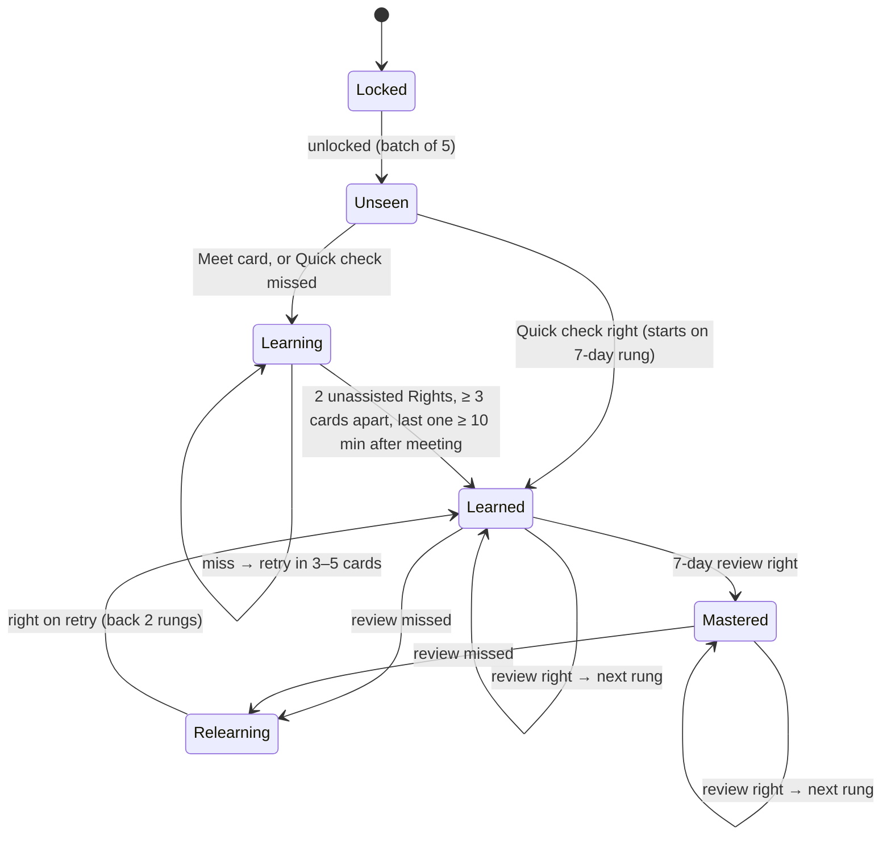

$$  $$# Adaptive learning: review and recommended design

*29 Oct 2026. A review of [plan-adaptive-learning.md](plan-adaptive-learning.md) against the
code on `dev`, and the design I recommend building.* Not read for this: Spec v2 and the
"How SA Birds Teaches" page (not in the repo), so the simulation numbers are taken as given.

**In short:** the plan is sound and most of it should be built as written: per-bird states,
the review ladder, Recover / Steady / Stretch, the pool mix, unlocking by mode, a daily goal and
a forgiving streak. Five changes would make it noticeably better:

1. **Don't quiz a bird the player has never seen.** A brand-new bird is a "Meet" card (name
   shown, not graded), or a "Quick check" for players who already know most birds. Today a
   novice's first sight of a bird is a near-certain miss, and that's what drags their accuracy
   down and keeps 30% of their cards in Recover.
2. **Bring a missed bird back 3–5 cards later**, not after 8+. Getting it right on the retry is
   the best learning in the app and the best "win" for a struggling player.
3. **Count the daily goal in cards, not Right answers.** Counting Rights rewards pressing
   "Got it" when you didn't, and makes the goal slower to reach in Stretch, when the player is
   doing *well*.
4. **Make "first-sight" skill drive how new birds are shown.** One number (how often the player
   names a bird they've never practised) decides between Meet cards and Quick checks. Experts
   then race through the birds they know and land on Hard birds and calls without picking a
   level, which also makes switching areas and levels painless.
5. **Pace new birds by tomorrow's review load**, not only by a daily cap of 20, and let easy birds
   skip ladder rungs. Otherwise the reviews pile up in week 3–6, which a 14-day simulation can't
   show.

Sections: [1. Where the app is today](#1-where-the-app-is-today) ·
[2. The plan: what to keep, what to change](#2-the-plan-what-to-keep-what-to-change) ·
[3. One bird's life](#3-one-birds-life-states-ladder-and-card-types) ·
[4. Weighting from wrong to right](#4-weighting-birds-from-wrong-to-right) ·
[5. Choosing the next bird](#5-choosing-the-next-bird) ·
[6. How new birds are shown](#6-how-new-birds-are-shown) ·
[7. User flows](#7-user-flows-four-players-over-three-months) ·
[8. Switching area, level, cards](#8-switching-area-level-and-card-type) ·
[9. Daily goal and streak](#9-daily-goal-streak-and-enjoyment) ·
[10. Building it](#10-building-it) · [11. Answers to the open questions](#11-answers-to-the-open-questions)

---

## 1. Where the app is today

How `app.js` / `progress.js` choose birds now:

| Rule | Code | Problem it causes |
|---|---|---|
| Start with the 20 commonest birds of the chosen levels and place | `PATH_FIRST`, `pathList()` | Fine for beginners; experts grind 20 birds they know. |
| Next batch when 40% of birds in play are mastered; batches grow 5, 10, 15 … | `growPath()`, `pathBatch()` | Batches reach 60–85 birds at once later on. |
| Mastered = right 3 times in a row | `MASTERED_STREAK` | Can happen in one sitting, 30 seconds apart. That's short-term memory, not learning. |
| 90% learning birds, 10% mastered birds | `MASTERED_SHARE` | Ignores how the player is doing right now. Mastered birds are never reviewed on a schedule, so they're forgotten quietly. |
| Weight = 1 + 2·wrong + hint − 0.5·right, over the bird's whole life | `weight()` | Never forgets. A bird missed 10 times in week 1 has weight 16 after 10 Rights (if they weren't in a row). |
| Any hint counts as a miss | `choose()` → `record("wrong")` | A player who needed "it's a Lapwing" and then picked the right one is treated like one who had no idea. |
| No bird within 8 cards of itself | `RECENT_MAX` | Also blocks the quick retry after a miss, which is when it helps most. |
| Next level ticked automatically | `growPath({ levelUp })` | Confusing (roadmap Q4). |

The plan's simulation shows the result: a novice on today's rules has 112 birds unlocked after
14 days but knows 26, and gets 49% right. That's the main thing to fix.

---

## 2. The plan: what to keep, what to change

### Keep as written
- **Pools** (Known, Due, Learning, Tricky, New) limited to Place ∩ Levels ∩ unlocked.
- **Three modes with momentum** `m ← 0.75m + 0.25x` and different enter/leave thresholds. Easy to
  explain, easy to log, easy to tune. A clever "continuous" controller would tune no better
  with 100–200 players and be much harder to reason about.
- **Unlocking by mode** ("add 5 when the pile is ≤ 5 / ≤ 8"). This replaces growing batches and
  answers roadmap Q3.
- **Review ladder** 1, 3, 7, 14, 30, 60, 120 days.
- **A rest day per 7** for the streak.
- **Trial on Dev behind a beta switch, then cohorts.**

### Change

| # | Plan says | Issue | Recommend |
|---|---|---|---|
| A | New pool: "~10% right for a novice" | Showing an unknown bird as a test is a near-certain miss. With 10% New in Steady, the novice's Steady is 68%, below target, so the loop works by pushing them into Recover (30% of cards), i.e. padding with birds they already know. | New birds start with a **Meet** card (not graded) or a **Quick check** (section 6). A first-sight miss doesn't change momentum. |
| B | No bird within 8 cards of itself | Blocks the retry. | A missed bird comes back after 3–5 cards, then again ~10 cards later (section 5, step 1). |
| C | Stretch: leave on **any** Wrong | Stretch is meant to run at ~72% for an expert, so they'd get a Wrong every 3–4 cards and bounce out. The simulation says experts stay in Stretch 80% of the time, which doesn't fit this rule. Worth checking the simulation. | Leave Stretch on **2 Wrong in the last 4**, or m < 0.75. |
| D | Daily goal: 10 Right answers | Rewards dishonest "Got it"; slower to finish when the player is in Stretch. | **Cards answered** (any result). Default 20 (~4–5 min). Section 9. |
| E | Learning / Tricky weight from the last 5 answers | Better than today, but it jumps: the weight falls off a cliff when a miss leaves the window. | A smoothed "miss score" per bird (section 4). Same idea, no cliffs. |
| F | Cap 20 new a day; none while 40+ overdue | After a 2-week holiday the player has 100+ overdue reviews and gets no new birds for days. Feels like a punishment for coming back. | Cap reviews per day at ~2× the goal, most valuable first; always allow 3 new birds a day. Pace new birds by tomorrow's expected reviews (section 5, "Pacing"). |
| G | Mastered = known on 2 later days | With a 1- then 3-day ladder that's day 4: still early. | Mastered = passed the 7-day review (reaches the 14-day rung, ~day 11). "★ Still remembered!" still shows on every later-day pass, so the player gets the celebration sooner. |
| H | One state per bird | Calls are much harder than photos; a bird known by sight is often unknown by ear. | Separate photo and call states, same ladder. A bird's call joins once its photo is Learned (unless the player studies calls only). |
| I | Simulation: 14 days | Reviews only start to pile up from week 3. | Run 90 days before tuning thresholds. |

---

## 3. One bird's life: states, ladder and card types



Each bird has this separately for **photos** and **calls**.

**What a review result does:**

| Result | Learning bird | Learned / Mastered bird on review |
|---|---|---|
| Right, fast (Reveal < 3 s), never missed before | counts toward graduating | up **2** rungs (easy bird: fewer reviews) |
| Right | counts toward graduating | up 1 rung |
| Right after a hint | doesn't count, doesn't reset | stays on its rung, due again tomorrow |
| Wrong | resets the "2 Rights" count; retry in 3–5 cards | **lapse**: Relearning in this session, then back 2 rungs (not to the start) |

Dropping 2 rungs instead of to the bottom matters: a bird forgotten after 60 days is still far
better known than a new one. Starting it over would bury the player in reviews.

**Card types.** The card type is the second difficulty dial, next to the mode. It's cheaper than
padding with easy birds because every card still teaches something.

| Card | Shown | When |
|---|---|---|
| **Meet** | Photo(s) with the name and one "look for" line (from the tips), call button. One button: "Next". Not graded. | First sight, for players who rarely know new birds. |
| **Quick check** | Normal card, buttons "I know it" / "Not sure". "I know it" → pick from 4 names, the bird's lookalikes as the other 3. | First sight, for players who often know new birds. |
| **Choose** | Normal card with the 4 names shown straight away (the existing Hint step 2). | The first test after a Meet; Learning birds in Recover. |
| **Recall** | Today's card: think, Reveal, Got it / Missed it. Hint available. | Everything else. |

---

## 4. Weighting birds from wrong to right

Inside the Learning and Tricky pools each bird has a **miss score** `e`, between 0 and 1:

```
after each answer:  e ← 0.6·e + 0.4·x      x = 1 Wrong, 0.5 Right after a hint, 0 Right
a new bird starts at e = 0.5
Tricky  = Learning with e ≥ 0.45
weight  = (0.3 + 3·e) × staleness
staleness = 1 + cards since this bird was last shown ÷ 20, at most 2
```

`e` is the plan's "misses in the last 5" without the cliff: recent answers count most and older
ones fade. Staleness stops a bird with a low score from disappearing for 100 cards.

**Worked example: a bird answered Wrong, Wrong, Right, Right, Right, Right**

| After | Today's code (lifetime) | Plan (last 5) | Recommended `e` | Recommended weight | Pool |
|---|---|---|---|---|---|
| Wrong | 3.0 | 3.0 | 0.70 | 2.4 | Tricky |
| Wrong | 5.0 | 5.0 | 0.82 | 2.8 | Tricky |
| Right | 4.5 | 4.5 | 0.49 | 1.8 | Tricky |
| Right | 4.0 | 4.0 | 0.30 | 1.2 | Learning |
| Right | 2.0, now "mastered" | 3.5 | 0.18 | 0.8 | Learning (graduates if ≥ 3 cards apart) |
| Right | 1.0 | 1.0 (a Wrong left the window) | 0.11 | 0.6 | Learned → leaves these pools |
| 1 more Right | 0.3 | 0.3 (the other one left) | — | — | — |

Today's code calls this bird mastered three cards after two misses, possibly all in one minute,
and from then on it's in the 10% group with no review date. The plan's last-5 rule holds it
at 3.5–4.5 and then drops it in two big steps as the misses leave the window. The recommended
score moves it gently from "show often" to "show now and then", and the ladder (not the weight)
decides when it comes back.

**Other pools:**
- **Due:** weight = 1 + days overdue ÷ interval, at most 3, so the most overdue (relative to its
  rung) comes first.
- **Known** (not due): in Recover, pick the birds **closest to being due**, not the safest
  ones. They're still very likely Right, and an early review of a nearly-due bird is worth
  something; a review of a Mastered-at-120-days bird is worth almost nothing.
- **New:** commonest first in the current place, but see "Lookalikes" below.

**Lookalikes** (`data/similar.json` and the player's own mix-ups):
- *Novices:* the next 5 new birds avoid each other's lookalikes (Cape vs Southern Grey-headed
  Sparrow wait until the first one is Learned). Very different birds are easier to tell apart
  at first.
- *Once a bird is Learned:* in Steady and Stretch, ~1 card in 8 is a **contrast card**: the bird
  the player last confused with it, or its top lookalike. Mixing confusable birds is what teaches
  people to tell them apart.
- *After a mix-up:* show the tip for that exact pair (roadmap "Later" for the tips branch).
  This is the most useful moment to show it.

---

## 5. Choosing the next bird

Runs after every answer. Steps 1–2 are fixed slots; step 3 is the plan's pool mix.

```
1. RETRY       A bird missed or lapsed in this session whose retry is due
               (3–5 cards after the miss, then ~10 cards after that) → show it as Recall.
               Recover: as a Choose card.
2. INTRO       Birds just unlocked, one at a time, as Meet or Quick check,
               spaced by the intro pattern below.
3. POOL MIX    Pick a pool by the mode's mix (empty pools give their share to the others),
               then a bird by weight within it.
4. GUARDS      Never 3 likely misses in a row (predicted chance < 60%): swap the third for
               a Known or Due bird. Never the same bird within 3 cards. Snoozed birds left out.
               At the start of a session, the first 2 cards are Due birds likely to be Right.
5. CARD TYPE   Photo or call track (section 8), then Meet / Quick check / Choose / Recall
               from the bird's state and the mode.
```

**Intro pattern** for a new bird A (Meet players), mixed with the normal cards:

```
Meet A · x · Choose A · x · x · Recall A · x · x · x · x · Recall A  → Learned if both Rights
```

Two new birds are never met back to back. If a batch is 5 birds, about 3 are met per session for
a Light player and all 5 for a Regular one.

**Modes (plan, with change C):**

| Mode | Enter | Leave | Mix: Known / Due / Learning / Tricky / New |
|---|---|---|---|
| Recover | 2 Wrong in a row, or m < 0.60 | 3 Right in a row → Steady | 55 / 15 / 25 / 5 / 0 |
| Steady | start | — | 15 / 25 / 40 / 10 / 10 |
| Stretch | 5 Right in a row, or m ≥ 0.85 | 2 Wrong in last 4, or m < 0.75 → Steady | 5 / 20 / 25 / 25 / 25 |

- Retries (step 1) count toward momentum: they're the quickest way out of Recover.
- Meet cards and first-sight misses don't count. First-sight Rights don't either: momentum is
  about birds being practised.
- Momentum carries through a session; after 30+ minutes away it goes back to 0.8.
- Recover takes 5% from Known and gives it to Due compared with the plan: same easy feel, more
  useful.

**Pacing new birds (change F).** Every bird learned costs about 4 cards today and ~5–7 reviews
over the next 4 months. So the number of new birds a player can take on depends on how many
cards they play, not just on how well they're doing:

```
expected reviews tomorrow = birds due tomorrow
unlock 5 more only if:   pile is small enough for the mode (plan)
                     and expected reviews tomorrow < 1.5 × the player's daily goal
                     and new birds today < 20 (first-sight Rights don't count)
always allow 3 new birds a day, even with a pile of reviews
reviews per day are capped at 2 × the goal; beyond that, most overdue (relative) first
```

Rough guide at ~5 cards a minute: a Regular player (20 cards a day) settles at ~2–3 new birds a
day after the first month, ~4–6 a day before that. A Keen player (40 a day) about double. Players
who play past their goal get more. The "skip a rung on a fast Right" rule (section 3) cuts
reviews by roughly a third for easy birds, which is what makes the Hard birds reachable.

**When there's nothing to practise** (everything Known, nothing due, can't unlock): "All caught
up! Extra practice won't change your schedule", then Known birds closest to due. A miss still
counts as a lapse.

---

## 6. How new birds are shown

One number decides it: **first-sight rate** `r`, the share of Quick checks / first sights the
player gets right, smoothed (`r ← 0.8r + 0.2x`). It starts from the onboarding answer.

| `r` | New bird shown as | Feels like |
|---|---|---|
| below 0.3 | **Meet** | "Here's a new bird", no test |
| 0.3 to 0.6 | **Quick check**, and "Not sure" opens a Meet card | "Do you know this one?" |
| above 0.6 | **Quick check** in runs of 5 | Ticking off birds they know |

Quick check "I know it" + right name → **Learned on the 7-day rung**, not counted toward the
daily new-bird cap or the pile. A wrong name or "Not sure" → Learning, with the name now shown.

This is what makes the app fit every level without asking the player to pick one. Experts
confirm the commons in a few minutes and the path moves on to the birds they don't know. A
novice who turns out to know more than they said climbs `r` and gets Quick checks too.

**Onboarding** (one screen, before the first card; skippable, default "Some"):
- "How well do you know Southern African birds?" — *Just starting* (r = 0.1) · *I know some
  garden birds* (0.4) · *I know most common birds* (0.7) · *Experienced birder* (0.9)
- "Where do you bird most?" — Near me / an area / anywhere in SA
- "How much time a day?" — Light 10 cards · Regular 20 · Keen 40 (changeable later)

---

## 7. User flows: four players over three months

Numbers are rough estimates for a player who plays most days; they line up with the plan's
simulation where they overlap (novice: ~40 unlocked, ~27 known at day 14).

### Beginner: "I can name a pigeon and a Hadeda"
*Onboarding: Just starting · Near me (Gauteng) · Regular. Photos only; levels: automatic from
Beginner.*

**First session (~5 min).** Card 1 is a Meet card: Hadeda Ibis, the name, "Look for: big grey
ibis, long curved bill, loud 'ha-ha-ha'". Card 2 meets a very different bird (Common Myna). Card 3
asks "Which one is this?" with 4 names for the Hadeda: easy, Right, ✓. Over 20 cards they meet 5
birds, get each tested 2–3 times, miss two and get both right on the retry. Accuracy ~85%; no
card felt like a trick. The goal ring fills: "Daily goal done! 🔥 1-day streak. 4 birds learned."

**Week 1.** Each day opens with 2 easy reviews (yesterday's birds), then a mix: ~40% Learning,
25% Due, 10% new. ~30 birds met, ~20 Learned. When they hit a run of misses (the 3 brown
sparrow-ish birds), Recover brings back Hadeda and Myna and a retry of the missed sparrow as a
Choose card. They never see the word "Recover". Mostly Steady, ~25% Recover.

**Week 2–3.** First "★ Still remembered!" on a 7-day review. ~45 birds met. Once 20 birds are
Learned by sight: "You know 20 birds by sight. Learn their calls too?" → Mixed cards; call cards
only for birds already Learned by photo, so a call card is never a total unknown.

**Month 1.** ~70 met, ~50 Learned, ~20 Mastered. First lookalike contrast cards (Cape vs Laughing
Dove). Calls ~20% of cards.

**Month 3.** All 50 Beginner birds for Gauteng done; "You know all 50 commonest birds here!" They
move into Easy birds without doing anything; the summary says "now Easy". ~130 birds met. Reviews
are ~60% of their cards, which is why the pacing slows them to 2–3 new birds a day.

**What keeps them:** wins early, small daily goal, streak, visible "learned" count.
**Main risk:** a busy week, coming back to 60 overdue. Section 5 caps reviews at 40 a day and
still gives 3 new birds.

### Novice: "I know my garden birds"
*Onboarding: Some garden birds · Cape Town · Regular.*

**First session.** The first 10 new birds are Quick checks (r = 0.4). They know Cape Robin-Chat,
Cape Sugarbird, Hadeda; they say "I know it" to a Cape Bulbul and pick Sombre Greenbul: miss, but
it's a first sight, so no momentum hit, and it goes to Learning. Unknown ones open as Meet
cards. "You already know 14 of the 50 commonest birds here." They practise the rest.

**Week 1.** r settles ~0.35, so new birds alternate between Quick check and Meet. Mostly Steady,
some Stretch on good days. ~40 birds unlocked, ~30 Learned (14 of them confirmed on day 1).

**Month 1.** All Cape Town Beginner birds and ~40 Easy ones. Calls offered in week 1 (they
already had 14 Learned). Tricky pool: LBJs (cisticolas, prinias) with contrast cards and tips.

**Month 3.** Easy done for Cape Town; they plan a Kruger trip and switch area (section 8):
"Kruger: you know 31 of its 60 commonest birds. 29 to meet." The first new birds are Kruger's
commonest, and their Cape Town birds keep their reviews.

### Intermediate: "I know most common birds, weak on LBJs and calls"
*Onboarding: Most common birds · Anywhere in SA · Keen.*

**First sessions.** r = 0.7, so new birds are Quick checks in runs of 5. Quick checks take ~4 s
each, so 40 cards confirm ~30 birds. By day 3: ~180 confirmed (Beginner + most Easy), ~25 in
Learning (the misses). These confirmed birds go on the 7-day rung, so they come back for review
in week 2 and the pacing rule spreads them out.

**Week 1–2.** Mostly Stretch (~60%), with Steady after misses. New birds are mostly Medium:
larks, pipits, cisticolas, warblers. Their accuracy settles ~80%: a real challenge, not a wall.
Lookalike contrast cards make up a good share of Stretch. Calls: their call track starts
almost empty, so call cards for their 180 photo-Learned birds come in as Quick checks too.

**Month 1–3.** ~300 Learned by photo, ~120 by call. The progress screen is where they spend
time: families with gaps ("Cisticolas: 4 of 11").

**Main risk:** boredom in the first hour. Quick checks fix it.

### Expert: "I lead bird walks"
*Onboarding: Experienced birder · Anywhere · Keen, calls and photos.*

**First sessions.** r = 0.9: runs of Quick checks with lookalikes as the 4 names, so "I know it"
is actually checked. ~600 birds confirmed in the first week at their own speed (the daily cap
doesn't count them). Their misses are the real learning list: ~40 Hard birds, vagrants, a few
seabirds.

**After week 1.** In Stretch ~80% of the time. Most cards are Hard birds, calls, and Due reviews
of the birds they confirmed (fast; most skip 2 rungs). Their accuracy ~85–90%, which is fine:
for experts the value is calls and the Hard lookalikes, not an 80% target.

**What keeps them:** calls, Hard birds, "Mastered" counts per family, area prep before trips.
**Main risk:** reviews of birds they obviously know. The skip-2-rungs rule and starting on the
7-day rung keep these to a few a day.

### Side by side (rough)

| | Beginner | Novice | Intermediate | Expert |
|---|---|---|---|---|
| First new birds shown as | Meet | Quick check / Meet | Quick check | Quick check (lookalike names) |
| Usual mode | Steady, ~25% Recover | Steady | Stretch ~60% | Stretch ~80% |
| Accuracy | ~80% | ~80% | ~80% | ~85–90% |
| Learned, day 14 | ~30 | ~45 | ~200 | ~600 |
| Learned, month 3 | ~110 | ~180 | ~400 | ~750 |
| Calls start | ~week 2 | week 1 | day 1 | day 1 |

---

## 8. Switching area, level and card type

The rule that makes switching smooth: **knowledge belongs to the bird, not to the settings.**
Every bird has one state (per photo/call) wherever and however it's studied. Settings only
change which birds are eligible.

**Unlocked birds are a set of bird IDs on the account**, not a count per level combination as
today (`sabirds.progression.v1`). This also fixes the "settings don't follow the account" bug if
it's synced together with the settings.

**Area.**
- Eligible = area birds ∩ level ceiling ∩ unlocked. New birds come in the area's own order of
  commonness.
- If fewer than 5 birds would be in the Learning pile, unlock the area's commonest unseen birds
  straight away (up to 5; Quick check players get a run of Quick checks).
- On switching, one line: "Kruger: you know 31 of its 60 commonest birds. 29 to meet."
- Momentum and mode don't change.
- Due reviews for birds outside the area: still due, shown when the player returns, or included
  at ~10% if they've been away from that area more than a week (so trips don't wreck old
  reviews). Simpler v1: reviews ignore the area filter entirely. I'd start with the simple one.
- A named area ignores the country ticks (roadmap, part 6).

**Level.** Replace the four level checkboxes with a **ceiling**:
`Automatic (recommended) · up to Beginner · up to Easy · up to Medium · Everything`.
- Automatic moves up when the current level is done for this area, with a celebration.
- A chosen ceiling is respected. When it's done: "You've learned all Easy birds here. Add Medium?"
  Yes / Not now. It's never ticked for them (answers roadmap Q4).
- Want *only* Hard birds? Keep a "Just this level" option under it for experts.

**Family** (if it comes back): the same rules, a filter, commonest first, unlocking in 5s
(answers roadmap Q5).

**Photos / Calls / Mixed.** Separate tracks. "Calls" mode shows the call track of every eligible
bird; "Mixed" shows calls only for photo-Learned birds, about 1 card in 3 once there are 10 such
birds. Switching never resets anything.

---

## 9. Daily goal, streak and enjoyment

**Daily goal = cards answered**, any result (Meet and Quick check cards count). Light 10 ·
Regular 20 · Keen 40. Ring in the top bar: "12 / 20 today".
- Why not Rights: honest "Missed it" must never cost the player, and Stretch shouldn't be slower
  to finish than Recover. Show Rights and birds learned in the summaries instead.
- The day starts at 03:00 local time, so a late-night session counts for the day it started.

**Streak** as in the plan, plus:
- The rest day is automatic and shown: "🔥 12 (rest day used this week)".
- Milestones at 3, 7, 14, 30, 50, 100 days.
- When it breaks: "Longest streak: 23 days. Start a new one today." No guilt.
- Skip freezes in v1; the automatic rest day does the same job without a shop.
- "Sign in to keep your 5-day streak" (plan): good, it's the best sign-in reason yet.

**Show the mode?** Only the good news. Entering Stretch: a short "On a roll — harder birds
coming". Recover is never named; at most "Let's warm up with a few you know". Players shouldn't
be told the app thinks they're struggling.

**Summaries** as in the plan, built from the answer log: opening ("Yesterday: 6 new birds, 2
mastered. Today: 0 / 20"), after the goal, weekly on Mondays.

**Other things that make it enjoyable** (small, after the core):
- Milestones by place and family: "All 50 commonest birds of Cape Town ✓", "Every sunbird".
- A "My birds" view of Mastered birds with their best photo, like a life list.
- Season: new birds present in the area this month first (`data/info/*.json` has months).
  Good for "what will I see this weekend".

---

## 10. Building it

**Code shape.** Put the learning logic in one new file, `learn.js`, with no DOM and no
`localStorage`: functions that take the state and return the answer:
- `answer(state, birdId, track, result, msToReveal, now)` → new state
- `nextCard(state, eligible, now, rng)` → `{ birdId, track, cardType, pool, mode }`
- `unlockIfReady(state, eligible, now)`, `dueCount(state, day)`

`app.js` then calls these from `record()` and `pickSpecies()`, and `progress.js` reads states
from it. Write it so Node can load it too, and a `scripts/simulate.mjs` can run the same code
for the 90-day simulation and every later tuning change. Then the simulation tests the real
code, not a copy of the rules.

**Data per bird and track:** `state, rung, due, lapses, e, rightsInRow, lastShownCard, firstSeen,
firstSightRight`. Per player: `mode, m, r, goal, streak, restUsedWeek, unlocked[], settings`.
Sync: add these to `sync_push` / `sync_pull` (a `state jsonb` per bird is simplest) and a
profile row for the player fields.

**Migrating today's progress:** mastered (streak ≥ 3) → Learned, due today (plan); any answers →
Learning with `e` from wrong ÷ (right + wrong); birds in `seenBirds` without answers → Learning.
Unlocked set = today's path for the player's current levels.

**Log with each answer** (plan, plus): card type, track, `r`, whether it was a retry or contrast
card, time to Reveal. Dashboard: time in each mode, accuracy by mode and card type,
**first-review recall** (the real measure of learning), birds Learned per minute played, goal
reached, streaks, day 1 / 7 / 30 return.

**Order** (the roadmap's 9 parts, adjusted):
1. Bird states, photo and call tracks, unlocked set, settings on the account (fixes the bug).
2. `learn.js` + 90-day simulation. Check the Stretch exit (change C) here.
3. Answer logging.
4. Grading: Right / assisted / Wrong; ladder with skip-2 and lapse-back-2.
5. Next bird: retries, intro pattern, pools, modes, guards.
6. Meet, Choose and Quick check cards; first-sight rate; onboarding screen.
7. Settings: area/level ceiling/tracks.
8. Daily goal and streak, summaries.
9. Celebrations and progress screen.
10. Trial: beta switch, then cohorts. Tune in this order, 2 weeks each: mode thresholds,
    pacing, the mix.

Items 1–5 are the plan's core. Item 6 is the biggest addition and the one that most changes how
the app feels for beginners and experts; if time is short, ship Meet cards first and Quick checks
second.

---

## 11. Answers to the open questions

| Question (plan / roadmap) | Recommendation |
|---|---|
| Show the mode to players? | Only Stretch, as good news. Never name Recover. |
| What counts toward the daily goal? | Cards answered, any result. |
| Rest day enough, or freezes? | Rest day only for now; check streak data in the trial. |
| Stretch: New from the next level up? | Yes when the level ceiling is Automatic; with a chosen ceiling, ask first. |
| Hinted Right = half a point? | Yes for momentum (0.5) and `e`; on the ladder it neither moves up nor counts as a lapse. |
| Fast-track daily limit? | Not needed: Quick check Rights don't count toward the cap, and land on the 7-day rung so they're checked again. |
| Separate photo and call states? | Yes, two tracks on the same ladder. |
| Batch size later on (Q3)? | Gone: always 5, unlocked when the pile is small. |
| Unticking an auto-added level (Q4)? | Level ceiling; never ticked for the player. |
| Studying a family (Q5)? | A filter with the same gradual unlocking. |
