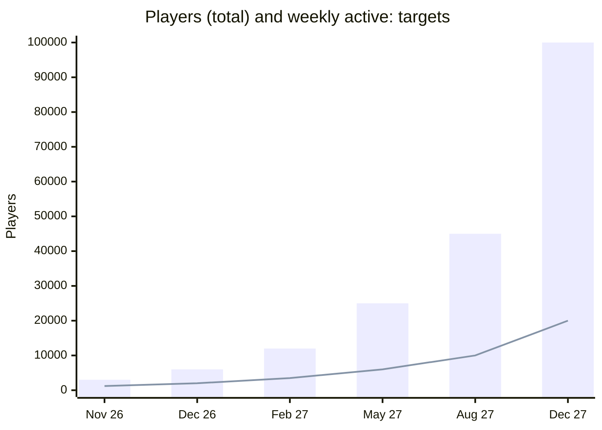
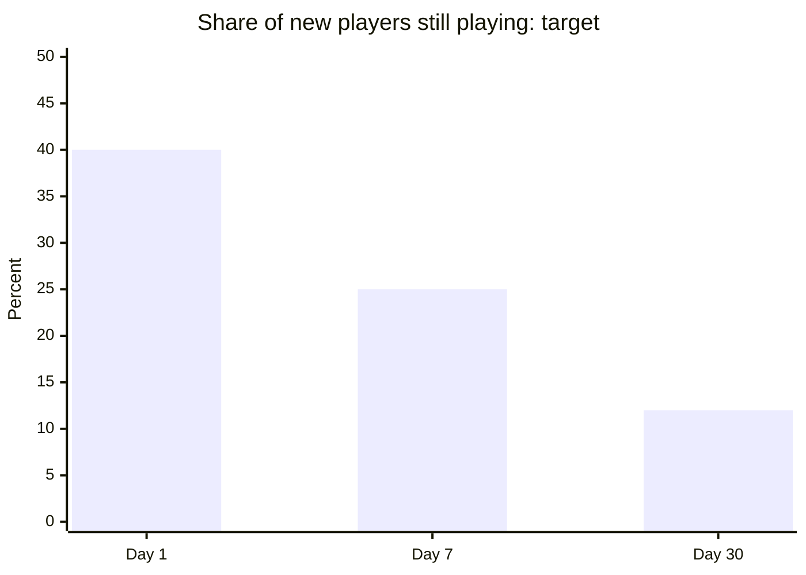
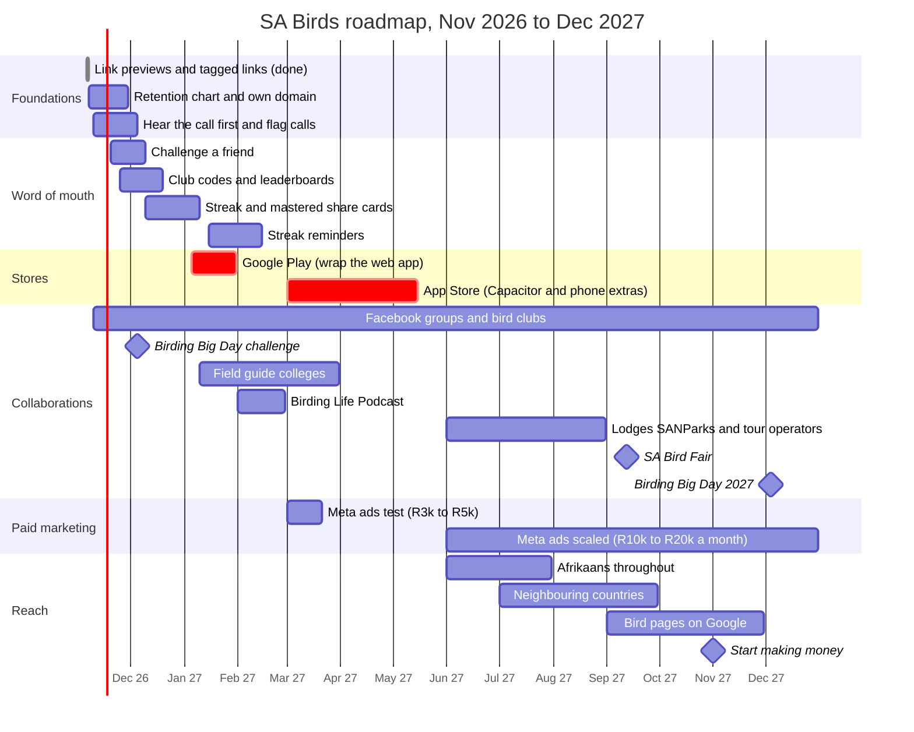
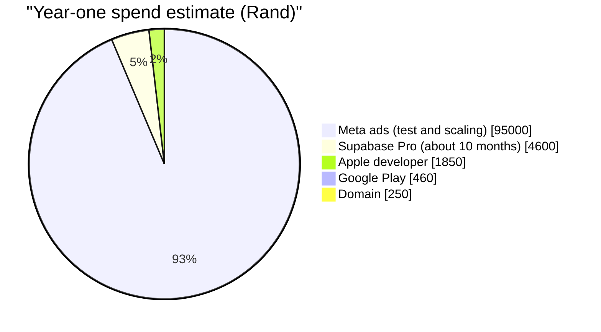

# SA Birds growth plan

*Written 6 Nov 2026. Review it on the first of every month against the dashboard.*

> **The order:** keep players → each player brings the next → go where birders gather → app stores → paid ads → money.

---

## Where we are today

| | 6 Nov 2026 |
|---|---|
| Players | **1,446** |
| Google accounts | 311 (+295 this week) |
| Active this week | 1,399 |
| Busiest day | 909 active players |
| Answers given | 45,880 |
| Birds mastered | 5,786 |
| New players who came back on a later day | **14%** (target 40%) |

Most players arrived in the last week, so the return rate will rise as they get time to come back. Even so, **getting players to come back is job number one.**

---

## Player targets

*Bars: total players. Line: active in the week.*

| By | Players | Weekly active | Main driver |
|---|---:|---:|---|
| 30 Nov 2026 | 3,000 | 1,200 | Link previews, tagged links, clubs and Facebook groups |
| 31 Dec 2026 | 6,000 | 2,000 | Birding Big Day, summer holidays, challenge-a-friend |
| 28 Feb 2027 | 12,000 | 3,500 | **Google Play**, club groups, field guide colleges |
| 31 May 2027 | 25,000 | 6,000 | **App Store**, first Meta ads |
| 31 Aug 2027 | 45,000 | 10,000 | Meta ads scaled, neighbouring countries |
| 31 Dec 2027 | 100,000 | 20,000 | Bird pages on Google, Bird Fair, press |

These are targets, not forecasts. If the real numbers run well ahead or behind, reset them.

---

## Engagement targets

This is the real health check. Growth on top of a leaky app is wasted.

| Measure | Now | Target | Why it matters |
|---|---:|---:|---|
| Came back on a later day | 14% | **40%** | Did the first session hook them? |
| Still playing after a week | — | **25%** | The main health check. Below 15%: fix the app before pushing growth |
| Still playing after a month | — | **12%** | A habit has formed |
| Weekly active ÷ all players | — | 30%+ | Not just collecting sign-ups |
| Daily players reaching 25 Right (a sticker) | — | 35% | The sticker loop works |
| Players who share at least once | — | 10% | Word of mouth is happening |
| New players arriving from a share or invite | — | 30%+ | The app spreads on its own |
| Players signed in with Google | 22% | 30% | Signed-in players keep progress and come back more |

The dashboard's **Where new players come from** table shows the first three for each link.

---

## Milestones

Event dates are estimates: Birding Big Day is usually the first Saturday of December, and the Bird Fair is in September. Check birdlife.org.za each year.

### The big moves and what must be true first

| Move | When | Go only if | Cost |
|---|---|---|---|
| 🤖 **Google Play** | Jan 2027 | Own domain live; players coming back on a later day ≥ 30% | US$25 once |
| 🍎 **App Store** | Apr–May 2027 | Google Play reviews are good; notifications, offline packs and a widget built (Apple turns down plain website wrappers) | US$99 a year |
| 📣 **First Meta ads** | Mar 2027 | Still playing after a week ≥ 20% | R3,000–R5,000 test |
| 📈 **Scale Meta ads** | Jun 2027 | Under R15 per new player still playing a week later | R10,000–R20,000 a month |
| 🤝 **Big partners** (BirdLife SA, SANParks, Roberts/Sasol) | From Feb 2027 | 10,000+ players to show them | Free |
| 💰 **Start making money** | Late 2027 | 50,000+ players; still playing after a month steady at ~12% | — |

**Why Google Play first:** about 76% of SA phones are Android. The web app can go on Google Play almost as it is, while the App Store needs real phone features first. Birders may lean to iPhones more than average, so check the iPhone share in your own data before planning the App Store spend.

---

## Phase by phase

### 1. November 2026 – Foundations · target 3,000 players

- [x] Link previews for WhatsApp and Facebook
- [x] Tagged links (`?from=`) and the **Where new players come from** table
- [ ] Find out what caused the early November spike, and do more of it
- [ ] Retention chart on the dashboard (day 1, 7, 30)
- [ ] Own domain, e.g. `sabirds.co.za` (needed for Google Play)
- [ ] Top tester requests: hear the call before the reveal, flag wrong calls
- [ ] Message the admins of the BirdLife SA Facebook group and 3–5 other groups
- [ ] Email 10 bird clubs

### 2. December 2026 – Birding Big Day and holidays · target 6,000

- [ ] Challenge-a-friend links (the same 10 birds, both scores shown)
- [ ] Club and group codes with weekly leaderboards
- [ ] Birding Big Day challenge in the app (likely Sat 5 Dec), offered to clubs to share
- [ ] Share cards for streaks and mastered birds
- [ ] "Learn the birds before your holiday" posts. Summer is peak birding, and the migrants are back

### 3. January–February 2027 – Google Play · target 12,000

- [ ] Launch on Google Play (a Trusted Web Activity via Bubblewrap or PWABuilder: the same app)
- [ ] Ask the most active players for reviews in the first week
- [ ] Streak reminder notifications on Android
- [ ] Pitch field guide colleges before their new intakes
- [ ] Pitch The Birding Life Podcast

### 4. March–May 2027 – App Store and the first ads · target 25,000

- [ ] Meta ads test: short videos of the game (hear a call, guess the bird), aimed at people aged 30–65 in SA interested in birding, Kruger, SANParks, wildlife and photography
- [ ] App Store app built with Capacitor, with notifications, offline packs, a widget and stickers in Messages
- [ ] Launch on the App Store

### 5. June–August 2027 – Scale what works · target 45,000

- [ ] Raise ad spend only on ads that brought players who stayed
- [ ] Afrikaans throughout the app, and Afrikaans ads
- [ ] Namibia, Botswana, Zimbabwe, Mozambique through their bird groups
- [ ] SANParks, lodges and tour operators: "learn the birds before your trip"

### 6. September–December 2027 – Mainstream · target 100,000

- [ ] Stand or talk at the SA Bird Fair
- [ ] A Google-findable page for each of the 852 birds
- [ ] Birding Big Day 2027 as a national in-app event
- [ ] Press: local radio, News24 lifestyle, *Getaway*, *African Birdlife*
- [ ] Start making money: sponsors (optics, lodges, guides), a Pro version, and ads only for free players and never during a quiz

---

## Who to work with

### Facebook groups

| Group | Members | How to use it |
|---|---:|---|
| **BirdLife South Africa** | ~100,000 | The biggest. Ask the admins first; offer it as a free tool for beginners |
| **African Bird Club Community** | 28,000+ | All of Africa; good for the neighbouring countries later |
| **LBJ's, BBJ's and UFO's of South Africa** | ? | Bird ID help. Perfect for "Can you name these 5 LBJs?" posts |
| **SA Birders Club** | ? | Birding spots and know-how |
| **SA Rare Birds** | ? | Keen twitchers: small but influential |
| **Let's Go Birding South Africa** | ? | Beginner-friendly |
| **Southern Africa Birding** | ? | Stories and sightings |

*"?" = size not confirmed. Check on Facebook and fill in.*

**How to post without being treated as spam:**
- Message the admins first. Admins often share a useful free tool themselves.
- Post something useful (a 5-bird quiz, "the 10 most confused SA birds"), not an advert.
- Once per group, then only come back with something new.
- Give each group its own tagged link.

### Collaborations

| Partner | What they get | What we get | When |
|---|---|---|---|
| **41 BirdLife-affiliated clubs** (Cape Bird Club, Sandton, Northern Gauteng, eThekwini KZN, Wesvaal, KZN Midlands, Hermanus, Lakes, Stanford…) | A free club group and leaderboard for training beginners | Newsletters and WhatsApp groups. Use Groot Brak as the example | From Nov 2026 |
| **BirdLife South Africa** (about 5,000 paying members, a newsletter, *African Birdlife*) | A tool that brings beginners into birding; a Birding Big Day challenge | The most committed birders and credibility | Dec 2026; bigger once at 10,000+ players |
| **Field guide training** (FGASA, Bushwise, Limpopo Field Guiding Academy, WildlifeCampus) | A course group with a leaderboard and call ID practice | A whole class every intake | Jan–Mar 2027 |
| **The Birding Life Podcast** and young birders (e.g. Liam Botha, John Kinghorn) | A story: "the app that taught 1,000s of people SA birds" | Listeners and short "Can a birder beat the app?" videos | Feb 2027 |
| **SANParks, lodges, tour operators** | "Learn the birds before your trip" links for guests | Travellers before they go | Jun–Aug 2027 |
| **Roberts / Sasol eBirds** | Players who then want a full field guide | Possible partner or sponsor later | Late 2027 |

**The pitch:** *Roberts tells you about the bird. SA Birds helps you remember it.* It's free, it's a game, and nobody else in SA does this. Don't knock the guides: their users are our audience.

---

## Budget

| Item | Cost | When |
|---|---|---|
| Domain | about R150–R300 a year | Nov 2026 |
| Google Play | US$25 once | Jan 2027 |
| Supabase Pro | US$25 a month | Once about 3,000–5,000 players a day (the free plan allows 5 GB of downloads a month) |
| Apple developer account | US$99 a year | Mar 2027 |
| Meta ads | R3,000–R5,000 test, then R10,000–R20,000 a month | Mar 2027, then from Jun 2027 |

*Ads are the only large cost, and they only start once players stay. Without ads, year one costs under R8,000.*

---

## Every month

1. Dashboard: players, weekly active, return rates, and which tagged links worked.
2. Keep the best channel, drop the worst.
3. Fix the top player complaint.
4. Post one new thing in the groups that worked.
5. Update the "Now" column and the checkboxes in this plan.
